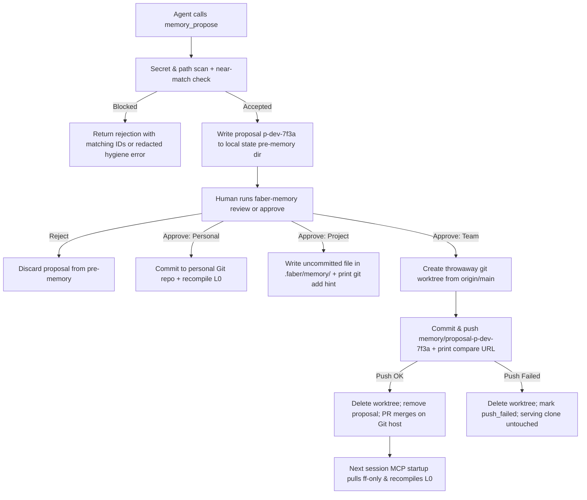

# FaberSEP Memory (`@fabersep/memory`) — Product Requirements Document (PRD)

> **Approved by the owner on 2026-11-26** ("spec tamamdir simdi").
>
> **Purpose:** Defines the intended behavior, user goals, functional requirements (`FR-01`–`FR-09`), boundaries, and edge cases for `@fabersep/memory` v0.1 (**WHAT** and **WHY**), the foundational Layer 0 open-source component of the FaberSEP engineering context stack (`@fabersep/memory` -> `@fabersep/spec` -> `@fabersep/atlas`). Verification scenarios live in [acceptance_criteria.md](acceptance_criteria.md).
>
> **Location Note:** Staged in the review ledger; moves to the dedicated `fabersep/memory` repository at implementation start. Tracked on Work board card `#395`.

---

## 1. Capability Scope Matrix

| Capability | Target Release | Priority | Primary User / Caller | Status |
| :--- | :--- | :--- | :--- | :--- |
| **Multi-scope Git-backed Markdown storage (solo & team modes, custom paths)** | `v0.1` | `P0 (Must Have)` | Solo developer, Engineering team | `Planned` |
| **Deterministic L0 prefix compiler with hard token budget & CI gate** | `v0.1` | `P0 (Must Have)` | CLI, MCP server, Team CI | `Planned` |
| **Minimal 3-tool local MCP server with in-memory progressive-disclosure search** | `v0.1` | `P0 (Must Have)` | AI coding agents (Antigravity, Claude, Cursor, Codex) | `Planned` |
| **Read-only active memory + `pre-memory` staging & human approval workflow** | `v0.1` | `P0 (Must Have)` | AI coding agents (propose), Human reviewer (approve/reject) | `Planned` |
| **Deterministic secret & machine-path hygiene scan** | `v0.1` | `P0 (Must Have)` | MCP propose, CLI approve & compile check | `Planned` |
| **Multi-engine non-destructive `init` & per-engine delivery matrix** | `v0.1` | `P1 (Should Have)` | Solo developer, Engineering team | `Planned` |
| **Deterministic zero-LLM `import` CLI for existing memory sources** | `v0.1` | `P1 (Should Have)` | Solo developer, Engineering team | `Planned` |

---

## 2. Problem Statement & Value

### 2.1 Problem
AI coding agents lose architectural decisions, coding rules, and past lessons between sessions and across tools. Existing approaches force an awkward trade-off:
- **Engine-locked auto-memory** isolates knowledge per engine and lets agents overwrite rules without human approval.
- **Heavy vector/graph memory servers** require external databases, break Git/PR workflows, bloat prompt prefixes with dozens of MCP tool schemas, and inject dynamic text at session start that invalidates LLM prompt caching.
- **Ad-hoc static Markdown files** protect prompt caching but break down when scaling across projects, multiple team members, or multiple engines without a clean read-only sync, search, and approval flow.

### 2.2 Expected Outcome
Solo developers and teams get one lightweight, engine-agnostic, Apache-2.0 CLI and MCP server (`npx @fabersep/memory`) where:
- Committed plain Markdown files in Git (`HEAD` tree) are the sole source of truth.
- Active memory is strictly read-only for agents; every agent change lands in `pre-memory` for human approval.
- Global and team invariants compile deterministically into a compact, generated `MEMORY.md` prefix (never committed) that stays stable across sessions to maximize prompt-cache reuse.
- Detailed project and historical memories stay out of the prefix and are retrieved on demand through 3 minimal MCP tools using progressive disclosure (L0/L1 summaries -> L2 full entry).

---

## 3. Explicit Non-Goals

- **NG-01:** No external databases, vector stores, graph databases, or native binary addons (no SQLite/FTS5, Chroma, Neo4j, Postgres, or cloud SaaS) in v0.1 (`OQ-5`).
- **NG-02:** No engine-specific lifecycle auto-capture hooks (e.g., Claude-only `PostToolUse` daemons) in v0.1; all engines share the same explicit MCP + CLI contract.
- **NG-03:** No custom team RBAC or hosted review web UI in v0.1; team access control and approval rely on the team's Git host (branch protection and PR review).
- **NG-04:** No LLM-powered summarization or API key requirement for `import` or `compile` in v0.1; all CLI operations are 100% deterministic and offline-capable.
- **NG-05:** No cross-scope `overrides:` mechanism in v0.1; duplicate entry IDs across scopes fail compilation explicitly.
- **NG-06:** No background sync daemons or timers; synchronization happens only on MCP startup (non-blocking) or explicit CLI invocation.

---

## 4. Functional Requirements

### FR-01: Multi-Scope Storage & Configurable Roots
- Support three memory scopes, each backed by plain Markdown files:
  1. **Personal (`personal`):** User's own cross-project rules and preferences (default folder configurable; see `OQ-4`).
  2. **Team (`team`):** Optional shared private Git repository used by multiple team members or teams.
  3. **Project (`project`):** Optional repository-local folder (`.faber/memory/` by default; see `OQ-2`).
- **Solo mode onboarding:** When a user points to any local folder without an existing Git repository, initialization creates the directory if needed, runs `git init` automatically for versioning and rollback, assigns a persistent root UUID in user config, and allows adding a remote later without requiring one up front.
- **Team mode onboarding:** Connects to a user-provided Git repository URL (or existing local clone) as a dedicated read-only serving clone tracked on its default branch, assigned a persistent root UUID in user config.
- **Project root resolution order (deterministic):**
  1. MCP client `roots`, when the client supplies them and a root contains `.faber/memory/`.
  2. Otherwise, the server's current working directory (`cwd`), if it sits inside a Git repository containing `.faber/memory/`.
  3. Otherwise, no project scope is active.
  - Both `memory_search` metadata and `faber-memory status` report which resolution source (`mcp-roots`, `cwd`, or `none`) was used.
- **Custom and relocatable paths:** Users can specify any custom path during setup or relocate a configured memory root at any time via CLI configuration. Because the **local state directory** (storing generated `MEMORY.md` and `pre-memory` proposals) is keyed by the root's persistent UUID rather than its filesystem path, relocating a folder preserves all history and pending proposals cleanly.

### FR-02: Minimal Entry Schema & Temporal Validity
- Each memory entry is a single UTF-8 Markdown file with YAML frontmatter.
- **Derived identity (no drift):** Entry `id` is derived from the filename slug (filename without `.md`), and `scope` is derived from the containing root (`personal`, `team`, or `project`). Neither is required in frontmatter.
- **Required frontmatter fields:**
  - `summary`: Single-line concise description used for L0/L1 listings.
  - `type`: One of `rule`, `decision`, `lesson`, `preference`, or `reference`.
- **Optional frontmatter fields:**
  - `tags`: List of short keyword strings.
  - `status`: `active` (default), `deprecated`, or `superseded`.
  - `superseded_by`: Target entry `id` when `status` is `superseded`.
  - `l0`: `none`, `line` (default for `team` and `personal`), or `body` — controls whether and how the entry appears in compiled L0 (`none` excludes it from L0 while keeping it searchable via MCP; `line` emits its one-line summary; `body` emits its full Markdown body).
  - `last_verified`: ISO date (`2026-11-26` format) for human auditing; **never** emitted into compiled L0 output.
- Entries with `status: deprecated` or `status: superseded` remain in Git history and on disk, are excluded from compiled L0, and are excluded from default search results unless explicitly requested.

### FR-03: Deterministic L0 Compilation & Budget Enforcement
- **Committed `HEAD` tree as source:** Compilation and search indexing read strictly from the committed Git `HEAD` tree of each memory root, never from uncommitted working-tree files. Uncommitted edits in a memory root trigger a warning in `faber-memory status` and the next MCP tool response.
- **Generated, never committed, atomically written:** Compiled `MEMORY.md` is written to the **local state directory**, never committed to any memory repository, preventing merge conflicts across concurrent team PRs. Every write uses a temporary file in the same directory followed by an atomic rename under a per-state-directory lock shared by `compile` and `approve`, so concurrent runs never produce a half-written file and failed compiles leave the last valid `MEMORY.md` untouched.
- **Byte-identical determinism:** Generated output is determined solely by `(team/personal root Git commit hashes, compiler version)` so teammates at the same commits produce byte-identical `MEMORY.md`, completely independent of the working directory.
- **Scope boundaries:**
  - Global `MEMORY.md` compiles **only** active `team` and `personal` entries with `l0` set to `line` or `body`, ordered strictly as `team` first, then `personal`, sorted lexicographically by `id`. Global L0 compilation never reads project scope.
  - Project-scope memory is **never** merged into global `MEMORY.md`; in v0.1, project entries are compiled solely for on-demand MCP listing and search.
- **Cache-stability invariants:** Compiled `MEMORY.md` must never include timestamps, dates, `last_verified` values, pending proposal counts, or machine-specific absolute paths.
- **Deterministic token budget:** Token count is estimated using a fixed, compiler-versioned formula (`ceil(utf8_bytes / 4)`, explicitly documented as an approximation) so CI and local runs agree across platforms. Default budget: 1,500 estimated tokens.
- **Hard failure guards:**
  - Duplicate active `id` across `team` and `personal` fails global L0 compilation explicitly, naming both scopes and the colliding `id`.
  - Duplicate active `id` between `project` and `team`/`personal` never blocks global L0; it fails only project-level `compile --check` inside that repository, and MCP marks the colliding project entry as shadowed with a warning.
  - Exceeding the token budget fails compilation explicitly and lists the largest contributing entries — it never silently truncates.
- **CI gate:** `faber-memory compile --check` validates frontmatter schema, duplicate IDs (global scopes plus project scope when run inside a project repo), L0 token budget, and the hygiene scan (`FR-09`), exiting non-zero on any violation without writing generated artifacts into the repository.

### FR-04: Pure-JS In-Memory Index & Minimal 3-Tool MCP Server
- Runs as a local stdio MCP server (`npx @fabersep/memory serve`) implemented in TypeScript/Node with an in-memory search index (zero native addons, zero on-disk index files to manage or gitignore).
- Checks each configured memory root's `HEAD` commit on every tool call (cheap metadata check, no timer) and rebuilds the in-memory index automatically whenever any root's `HEAD` changes.
- Exposes **exactly 3 lean MCP tools** (combined schema target under 500 estimated tokens; tool list never mutates mid-session):
  1. `memory_search`: Queries entries by keyword, optional `scope` (`team`, `personal`, `project`, or all), optional `type`, and optional `include_pending` (default `false`). An empty query lists entries as L0/L1 summaries (`id`, `scope`, `type`, `summary`). Active entries only by default. Includes the resolved project root source in response metadata.
  2. `memory_get`: Fetches full L2 Markdown content, frontmatter metadata, and referenced links for one or more entry `id`s.
  3. `memory_propose`: Submits a proposal to `pre-memory` with `action` (`create`, `update`, or `supersede`), target `scope`, `summary`, `type`, `body`, and `target_id` (mandatory for `update` and `supersede`; rejected if missing or not found).
     - Runs a configurable near-duplicate similarity check against both active and pending entries.
     - If a near-match is found on `create` without `force_new: true`, rejects the proposal and returns the matching entry `id`s and one-line summaries so the agent can choose `update` or `supersede`.
     - Supports `force_new: true` with a mandatory non-empty `reason` (stored on the proposal for human review) to escape similarity false positives.
- `status` and `sync` are CLI-only commands and are **not** exposed as MCP tools, preventing agents from pulling or mutating active state mid-session.

### FR-05: Read-Only Active Memory & `pre-memory` Approval Workflow
- Active memory roots are strictly read-only for all agents; `memory_propose` writes **only** to the `pre-memory` folder inside the **local state directory** (keyed by root UUID, never inside a serving Git clone).
- **Collision-free proposal IDs:** Each proposal receives an ID combining a short user tag and random hex suffix (for example `p-dev-7f3a`) to avoid branch-name collisions across teammates.
- **Review & Approval CLI:**
  - `faber-memory review` is run manually by the user; it interactively displays pending proposals with diffs (for `update`/`supersede`), `force_new` reasons, and hygiene scan status, allowing the human to approve, edit before approving, or reject each proposal. Multiple proposals approved for the same root in one `review` session are **batched into a single commit, single push (when applicable), and single L0 recompile** to minimize prompt-cache churn.
  - After any `approve` or `review` that updates L0, print a single non-blocking informational line noting that the updated L0 applies to new sessions and that batching reviews at session end maximizes prompt-cache reuse.
  - `faber-memory approve p-dev-7f3a` and `faber-memory reject p-dev-7f3a` support non-interactive workflows.
  - `faber-memory status` reports configured root paths, project root resolution source, current `HEAD` commits, uncommitted-edit warnings, sync health, pending proposal count, and flags proposals older than a configurable staleness threshold (default 14 days).
- **Approval behavior by scope:**
  - **Personal (solo) mode:** Writes and commits the approved entry directly to the personal Git repository, removes the proposal from `pre-memory`, and recompiles L0.
  - **Team mode:** Always operates inside a throwaway `git worktree` checked out from `origin/main` (the configured default branch) so the serving clone never leaves its default branch and never becomes dirty. Supports configurable submit mode (`pr` or `auto` — default chosen at team onboarding, overridable per item in `faber-memory review`):
    - In `auto` mode (direct with PR fallback): commits and attempts to push directly to `origin/main`. If the push succeeds, deletes the worktree, removes the proposal from `pre-memory`, and triggers `sync` + L0 recompile. If the remote rejects direct push due to branch protection, automatically pushes branch `memory/proposal-p-dev-7f3a`, prints a Git host compare/PR URL, deletes the worktree, and removes the proposal from `pre-memory`.
    - In `pr` mode: pushes branch `memory/proposal-p-dev-7f3a` directly, prints a Git host compare/PR URL, deletes the worktree, and removes the proposal from `pre-memory`.
    - If pushing fails due to network, auth, or unexpected remote error, the throwaway worktree is deleted, the proposal remains in `pre-memory` marked `push_failed` with the error reason, and the serving clone is untouched.
  - **Project mode:** Writes the approved entry into `.faber/memory/` as an **uncommitted** file ("staged for commit") and prints `git add` / commit guidance so the user stays in full control of their active project branch. The entry becomes active only once committed to `HEAD`; until that file appears in `HEAD`, the proposal remains in `pre-memory` marked `awaiting_commit` (visible to `status` and duplicate checks), and any uncommitted-file warning names the file with commit guidance.

### FR-06: Sync Semantics & Cache-Safe Propagation
- No background timers or daemons.
- On MCP server startup, runs a non-blocking `git pull --ff-only` with a 5-second timeout for any remote-backed root.
  - If a pull succeeds and `HEAD` advances, rebuilds the in-memory index and recompiles L0 in the local state directory.
  - If a pull fails (offline, timeout, auth error, or dirty serving clone), continues serving the last known good committed state and attaches a single-line warning to the next MCP tool response.
  - If a serving clone has uncommitted local edits, refuses to pull and reports the dirty state without resetting or merging automatically.
- `faber-memory sync` runs the same `git pull --ff-only` and recompile on demand from the CLI.
- Compiled L0 updates take effect on the **next** agent session only: recompilation atomically replaces the state-directory file without emitting MCP notifications or mutating the server's registered tool list.

### FR-07: Deterministic Import & Migration CLI
- `faber-memory import --from markdown-dir /path/to/notes` (and equivalent source flags) deterministically converts existing memory sources into `pre-memory` proposals without requiring any LLM or API key.
- Supported v0.1 source types:
  - `markdown-dir`: One entry per Markdown file (mapping legacy frontmatter such as `name`/`description` into `summary`/`type`).
  - `claude-memory`: Imports Claude Code auto-memory directory entries one fact per file.
  - `agents-md` and `cursor-rules`: Imports each file as a single whole-file proposal by default, with an opt-in `--split-headings` flag to split by top-level headings.
- **Safety & non-destruction:**
  - Never modifies or deletes source files.
  - Reports entries that duplicate active or pending memory.
  - When importing `claude-memory`, prints the exact setting guidance to disable Claude auto-memory so future writes do not bypass `pre-memory`.
  - Routes all imported items into `pre-memory` by default (see `OQ-1` for optional `--approve` in solo mode).

### FR-08: Multi-Engine `init` & Per-Engine Delivery Matrix
- `faber-memory init` configures MCP server registration and L0 pointer wiring across engines.
- **Strict file-safety rules:**
  - Writes pointers **only** into user-level uncommitted files (never writes machine-specific paths into committed project files such as a repo's `AGENTS.md` or `CLAUDE.md`).
  - Always compiles L0 once **before** writing any pointer so no engine points at a missing file.
  - Edits existing user instruction files only inside idempotent managed blocks (`<!-- faber-memory:start -->` ... `<!-- faber-memory:end -->`).
  - Applies by default and saves a `.bak` backup before the first edit; `--preview` (alias `--dry-run`) prints the diff without writing; `--apply` is kept as an alias (owner decision 2026-11-27, Work board #400).
  - `faber-memory init --undo` removes **only** the managed blocks and the MCP entries added by `init`; it preserves any user edits outside the managed blocks and prints the `.bak` path without auto-restoring it.
  - Any optional hint committed to a project repository is a single pathless line (`Project memory: run npx @fabersep/memory init`).
- **Per-Engine Delivery Matrix (unverified cells remain `UNKNOWN` / `GAP` until verified against the real tool prior to release):**

| Engine | User-Level Instruction File | Import Expansion | MCP Config Path | Project Root Source | Prompt Position & Cache Verification |
| :--- | :--- | :--- | :--- | :--- | :--- |
| **Claude Code / Desktop** | `~/.claude/CLAUDE.md` | Verified (`@~/.path` expanded in Claude Code) | `~/.claude.json` (Code), `~/Library/Application Support/Claude/claude_desktop_config.json` (Desktop macOS) | `cwd` (or MCP `roots` when client supplies them) | `PENDING` (controlled benchmark) |
| **Antigravity (`agy`)** | `~/.gemini/GEMINI.md` | Verified: **No** (`@path` is passed literally, not expanded; user-level managed block uses explicit read instruction + MCP) | `~/.gemini/config/mcp_config.json` | `cwd` (or MCP `roots` when client supplies them) | Verified (`gemini-3.8-flash-low`, 3-turn fresh session, 17-entry 760-tok L0 + 3 MCP tools): **82.2%** warm Turn 2, **81.8%** warm Turn 3 (**68.6%** cumulative incl. cold Turn 1) |
| **Cursor** | `GAP` (not verified on host) | `GAP` | `~/.cursor/mcp.json` (MCP-only) | `GAP` | `GAP` |
| **Codex CLI** | `GAP` (not verified on host) | `GAP` | `~/.codex/config.toml` (`GAP`, MCP-only) | `GAP` | `GAP` |

- Any engine whose user-level import mechanism cannot be verified is marked `GAP` and wired for MCP-only delivery (never given a workaround that writes machine paths into a committed repo).
- Before publishing cache-efficiency claims, run a controlled measurement benchmark per verified engine (fresh session, fixed L0 + 3 MCP tools, repeated calls within cache window, reporting actual cache-read ratio).

### FR-09: Secret & Machine-Path Hygiene Scan
- Runs a deterministic pattern scan on every `memory_propose` call, every `approve`, and every `compile --check`.
- Rejects proposals or fails checks containing:
  - Common secret patterns (API keys, private key headers, bearer/JWT tokens, high-entropy credential assignments).
  - Machine-specific absolute paths (e.g., `/Users/alice/`, `/home/bob/`, `C:\Users\alice\`) in entry content or compiled L0.
- Returns clear diagnostic messages identifying the offending line and pattern category while redacting raw secret values from output and logs.

---

## 5. Primary User / Execution Flow

---

## 6. Edge Cases & Failure Modes

| Condition | Expected System Response |
| :--- | :--- |
| **Fresh clone / first run before compile** | `init` always compiles L0 before writing user-level pointers; MCP server compiles on startup if generated L0 is missing. |
| **Uncommitted edits in a memory root** | Compile and index read committed `HEAD` only; `status` and next MCP tool response warn about uncommitted edits without mutating or resetting them. |
| **Dirty serving clone during sync** | `pull --ff-only` refuses to run, never resets or auto-merges, continues serving last good committed state, and surfaces a clear warning on next tool call and in `status`. |
| **Offline or slow remote on MCP startup** | Non-blocking pull times out at 5 seconds; MCP serves local clone immediately and attaches a one-line sync warning to the next tool response. |
| **Team `approve` push fails mid-flight** | Throwaway worktree is always cleaned up; serving clone remains on default branch; proposal stays in `pre-memory` marked `push_failed` with error details. |
| **Near-match false positive** | Agent retries `memory_propose` with `force_new: true` and a mandatory `reason`; proposal is accepted and displays the reason prominently in `review`. |
| **Concurrent `approve` and MCP startup compile** | Per-state-directory lock + temp-file atomic rename guarantee a complete, uncorrupted `MEMORY.md` at all times; failed compiles leave the last good file untouched. |
| **Duplicate `id` across `team` and `personal`** | Global L0 `compile` and `compile --check` fail explicitly naming both scopes and the colliding `id`. |
| **Duplicate `id` between `project` and `team`/`personal`** | Global L0 is unaffected; project `compile --check` fails, and MCP marks the project entry as shadowed with a warning. |
| **Approved project entry not yet committed** | Proposal stays in `pre-memory` marked `awaiting_commit` until the file appears in `HEAD`; active search excludes it, duplicate check still sees it, and warnings name the file with commit guidance. |
| **Compiled L0 exceeds estimated token budget** | `compile` and `compile --check` fail explicitly listing the largest entries by estimated token count; never truncates silently. |
| **Secret or absolute path in proposal/entry** | Rejected deterministically with pattern category and line number; raw secret value is redacted in diagnostics. |
| **User edits outside managed blocks before `init --undo`** | `--undo` removes only managed blocks and added MCP entries; user edits survive untouched and `.bak` is never auto-restored. |
| **Teammate without `@fabersep/memory`** | Committed project repo contains no machine paths or broken imports (at most one plain-text hint line). |
| **Stale forgotten proposals** | `faber-memory status` flags pending proposals older than the configured threshold (default 14 days); L0 never changes. |

---

## 7. Open Questions & Dependencies

All v0.1 product questions (`OQ-1`–`OQ-6`) were resolved by the owner on 2026-11-26:

| ID | Decision | Impact | Status |
| :--- | :--- | :--- | :--- |
| **OQ-1** | `import` stages in `pre-memory` by default; explicit `--approve` allowed in solo mode only. | UX / Safety | `Resolved` |
| **OQ-2** | Project-scope memory in `.faber/memory/` is committed to the project repo by default. | Team workflow | `Resolved` |
| **OQ-3** | Team submit supports direct push to `main` via throwaway worktree when branch protection is off, with automatic fallback to PR branch (`memory/proposal-<id>` + compare URL) when protected, plus explicit `pr` mode option. | Team workflow | `Resolved` |
| **OQ-4** | Default personal path `~/.faber/memory`; npm package `@fabersep/memory` (Apache-2.0). | Packaging | `Resolved` |
| **OQ-5** | Drop SQLite/FTS5 in v0.1; use pure-JS in-memory BM25 index (`F-4`). | Architecture | `Resolved` |
| **OQ-6** | Convert Brain's legacy frontmatter (`name`, `description`, `metadata.scope`) via `import` only. | Schema simplicity | `Resolved` |
