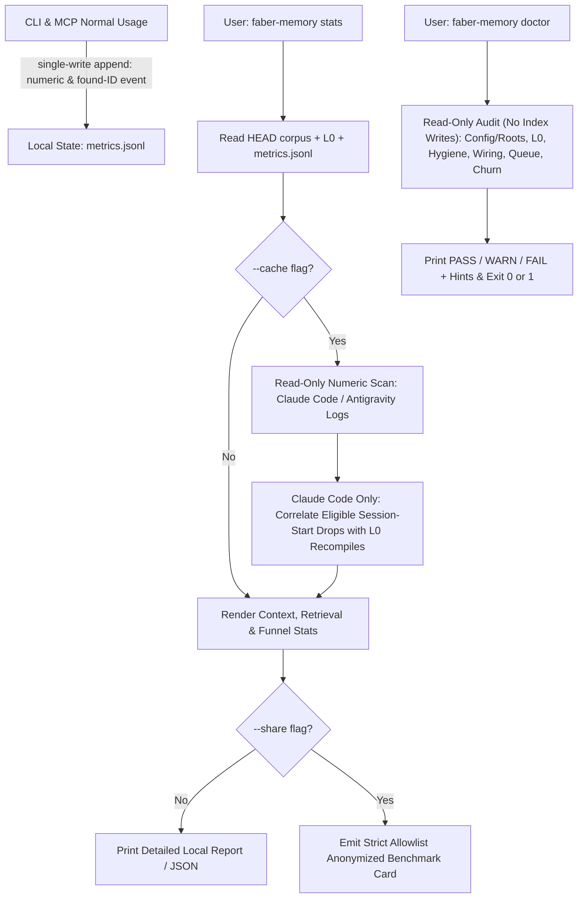

# FaberSEP Memory v0.2: Metrics, Stats & Doctor — Product Requirements Document (PRD)

> **Approved by the owner on 2026-11-27** ("sorular hepsi onerilerin tamam. dokumanlari guncelle. Sonra gelistirmeye baslayacagiz.").
>
> **Purpose:** Defines the intended behavior, user goals, functional requirements (`FR-01`–`FR-06`), boundaries, and edge cases for `@fabersep/memory` v0.2 local observability, prompt-cache measurement, anonymized benchmark export, and read-only health diagnostics (**WHAT** and **WHY**). Verification scenarios live in [acceptance_criteria.md](acceptance_criteria.md).
>
> **Tracking:** Work board card `#396` (under roadmap `#390`).
>
> **State directory convention:** Throughout this specification, the **state directory** refers to `$FABER_MEMORY_HOME/state` (defaulting to `~/.config/faber-memory/state` when `FABER_MEMORY_HOME` is unset).

---

## 1. Capability Scope Matrix

| Capability | Target Release | Priority | Primary User / Caller | Status |
| :--- | :--- | :--- | :--- | :--- |
| **Privacy-first local metrics ledger (`metrics.jsonl`)** | `v0.2` | `P0 (Must Have)` | MCP server, CLI (`compile`, `sync`, `init`, `import`, `review`, `approve`, `reject`) | `Implemented` |
| **Context, token efficiency & L0 stability report (`faber-memory stats`)** | `v0.2` | `P0 (Must Have)` | Solo developer, Engineering team | `Implemented` |
| **Runtime retrieval quality, entry temperature & pre-memory funnel** | `v0.2` | `P0 (Must Have)` | Solo developer, Engineering team | `Implemented` |
| **Read-only health diagnostics (`faber-memory doctor`)** | `v0.2` | `P0 (Must Have)` | Solo developer, Engineering team, CI | `Implemented` |
| **Opt-in prompt-cache hit measurement & L0 correlation (`stats --cache`)** | `v0.2` | `P1 (Should Have)` | Solo developer | `Implemented` |
| **Opt-in anonymized shareable benchmark card (`stats --share`)** | `v0.2` | `P1 (Should Have)` | Solo developer, Open-source community | `Implemented` |

---

## 2. Problem Statement & Value

### 2.1 Problem
`@fabersep/memory` v0.1 delivers prefix-cache-first L0 compilation, BM25 progressive disclosure, and human-gated `pre-memory`, but users currently have no way to verify whether their setup is actually working well in practice:
- **No proof of token savings or cache stability:** Users cannot see how much context L0 saves versus loading the full corpus, or whether frequent L0 recompiles are silently breaking LLM prompt caches.
- **Blind memory maintenance:** Without retrieval counters, users cannot tell which L0 entries are never used (wasting prefix budget), which searches return zero results (knowledge gaps), or how many duplicates/hygiene violations `pre-memory` caught.
- **Fragmented troubleshooting:** Checking Git root health, compiled L0 freshness, engine wiring (`init` blocks and MCP configs), hygiene, and stale proposals requires running multiple separate commands.

### 2.2 Expected Outcome
Solo developers and teams get a **100% local, zero-telemetry** observability and diagnostic suite (`faber-memory stats` and `faber-memory doctor`) that:
- Measures context reduction, L0 cache-break frequency, retrieval ratios, hot/cold/stale entries, and the `pre-memory` governance funnel without ever storing query text, proposal IDs, arbitrary unvalidated IDs, or memory content.
- Optionally reads only numeric token counters from local Claude Code and Antigravity session logs to measure real prompt-cache hit rates (and correlate L0 recompiles with cross-session cache drops in Claude Code).
- Generates an inspectable, strictly allowlist-anonymized Markdown/JSON benchmark card (`--share`) containing only aggregate numbers.
- Provides a single strictly read-only `doctor` command reporting `PASS` / `WARN` / `FAIL` across config/roots, L0, hygiene, engine wiring, proposals, and cache stability.

---

## 3. Explicit Non-Goals

- **NG-01 (Zero Telemetry):** No network calls, analytics pings, crash reporting, or automatic benchmark uploads. Every measurement stays strictly on the user's machine.
- **NG-02 (Zero Content Persistence):** No search query strings, proposal IDs (which embed user tags), arbitrary/not-found IDs, memory bodies, entry summaries, prompt text, or assistant responses are ever written to the metrics ledger or included in `--share` output.
- **NG-03 (No Auto-Fix in Doctor):** `faber-memory doctor` is strictly read-only in v0.2 (`--fix` is out of scope); it diagnoses and prints actionable hints without mutating user files, the Git index, or Git repositories.
- **NG-04 (No Remote MCP in v0.2):** Optional thin Remote MCP (Streamable HTTP + token auth for mobile/web chat clients such as Claude Mobile Custom Connectors) is explicitly deferred to a separate future feature (`03-remote-mcp`) so v0.2 preserves its zero-network security boundary.
- **NG-05 (No Dashboard or Daemon):** No web UI, background collector daemon, or external database; all reporting runs on-demand via CLI with zero runtime dependencies and zero native addons.

---

## 4. Functional Requirements

### FR-01: Privacy-First Local Metrics Ledger
- Store an append-only JSON Lines ledger at `metrics.jsonl` inside the state directory, never inside any Git memory repository.
- **Strict privacy invariant:** Each record may contain **only** event type, UTC ISO timestamp, numeric metrics (counts, durations in milliseconds, token estimates), L0 SHA-256 hash, scope name (`team`, `personal`, `project`), trigger/source/outcome enum values, hygiene category (`secret` or `machine-path`), and **found** memory entry identifiers (`scope:id`). It must **never** record proposal IDs (which embed the OS username), query text, arbitrary not-found ID strings, memory bodies, summaries, filesystem paths, usernames, or raw log lines.
- **Recorded events:**
  - `compile`: emitted on successful non-check L0 compilation. Before atomic replacement under the state lock, the existing `MEMORY.md` bytes (if present) are hashed to determine `initial` (`true` when no prior `MEMORY.md` existed) and `changed` (`true` only when a prior `MEMORY.md` existed and its SHA-256 differs from the new output). Also records `trigger` (`cli`, `sync`, `mcp-startup`, `approve`, or `init` — where `review`, `approve`, and `import --approve` all record `approve`), new L0 SHA-256 hash, estimated L0 tokens, active `team + personal` corpus estimated tokens, and active entry count.
  - `search`: emitted on `memory_search` with scope filter (if any), result count, zero-result flag, empty-query flag, and pure BM25 search latency in milliseconds (excluding Git `HEAD` refresh time).
  - `get`: emitted on `memory_get` with found entry identifiers (`scope:id` list capped at 50 entries; when more than 50 entries are returned, sets `ids_truncated: true` while still recording full counts), found count, not-found count (never recording raw not-found strings), and latency in milliseconds.
  - `propose`: emitted on `memory_propose` and `faber-memory import` with `source` (`mcp` or `import`), scope, action (`create`, `update`, `supersede`), outcome (`staged`, `duplicate_blocked`, `hygiene_blocked`, or `validation_error` — covering all validation failures including target-not-found and missing `force_new` reason), plus hygiene category when `hygiene_blocked`.
  - `review_outcome`: emitted on `review`, `approve`, `reject`, `reject --all`, and `import --approve` with scope and outcome (`approved_committed`, `approved_pushed`, `approved_pr`, `push_failed`, `awaiting_commit`, or `rejected`).
- **Concurrency, bounded storage & non-blocking fault tolerance:**
  - Each event is written via a single-write append with a 4 KB maximum line size.
  - Pruning removes records older than 90 days and, when file size exceeds 10 MB, trims oldest records down to an 8 MB target (leaving headroom so subsequent appends do not re-trigger pruning immediately). Pruning runs at most once per 24 hours — tracked via the modification time of a `metrics.pruned` marker file in the state directory — or whenever file size exceeds 10 MB, guarded by a dedicated non-blocking `metrics.lock` (single attempt; if busy, pruning is skipped for that call) and applied via temporary file + atomic rename. A tiny concurrent-append loss window during rotation is explicitly accepted.
  - Any filesystem error when appending to or pruning the ledger is swallowed silently (or logged only as a non-fatal warning) and must never fail an MCP tool call or CLI command.
  - `faber-memory reset` removes `metrics.jsonl` (and `metrics.pruned`) along with the rest of the local state directory and explicitly lists `metrics.jsonl` in its reset summary output.

### FR-02: Context Efficiency, Schema Footprint & L0 Stability (`faber-memory stats`)
- `faber-memory stats [--days N] [--json]` (default window: `30` days; valid integer range: `1`–`90` matching ledger retention). Invalid `--days` values (`0`, negative, `> 90`, non-integer) exit `1` with a clear validation error. When no configuration exists yet, `stats` exits `0` with a clear setup hint (`faber-memory setup`).
- Computes and displays:
  - **Corpus vs. L0 token efficiency (cwd-independent):** Total estimated tokens of all active `team` and `personal` entries rendered in full-body (`l0: body`) format versus compiled L0 `MEMORY.md` estimated tokens, context reduction percentage (`1 - (L0 / corpus)`, or `0%` when corpus is `0`), and L0 budget utilization (`compiled / tokenBudget`). When an active `project` root is detected from the current working directory, active `project` scope tokens are reported on a separate informational line and excluded from the L0 reduction ratio.
  - **MCP tool schema footprint:** Estimated tokens of the JSON-serialized definitions of the 3 exposed MCP tools (`memory_search`, `memory_get`, `memory_propose`) compared against the 500-token target.
  - **L0 stability (cache-break frequency):** Number of `compile` events with `changed: true` (non-initial hash changes) recorded in the last 7 days and in the selected `--days` window, flagging a cache-churn warning if more than 5 hash-change events occurred in the last 7 days.
- `--json` outputs a deterministic, versioned JSON object containing all computed sections for scripting or CI inspection.

### FR-03: Runtime Retrieval Quality, Entry Temperature & Pre-Memory Funnel (`faber-memory stats`)
- Using `metrics.jsonl` in the state directory filtered to the selected `--days` window, `faber-memory stats` reports:
  - **Ledger coverage:** Actual days of recorded history in the ledger alongside the requested `--days` window.
  - **Retrieval quality:** Total non-empty `memory_search` calls (excluding empty-query listings from denominator and zero-result counts), **get calls per search** ratio (`memory_get` calls divided by non-empty `memory_search` calls, uncapped because direct L0-to-`memory_get` calls may exceed 1.0), zero-result search count and percentage, and median (p50, lower-middle element for even counts) pure BM25 search latency in milliseconds.
  - **Entry temperature (separate lists):**
    - *Hot entries:* Top 10 retrieved entries ranked by `memory_get` hit count per `scope:id` in the window.
    - *Cold L0 entries:* Active entries currently included in L0 (`l0: line` or `l0: body`) with zero `memory_get` hits during the window — **withheld** (with an informational notice) whenever ledger coverage is shorter than the requested `--days` window (or fewer than 7 days) so new setups do not falsely flag every entry as cold.
    - *Stale L0 entries:* Active L0 entries whose `last_verified` date is older than 90 days — surfaced as candidates for review, `l0: none`, or `superseded`. Entries missing `last_verified` are reported separately as **unverified** rather than silently marked stale.
  - **Pre-memory governance funnel:** Counts of proposals grouped by `source` (`mcp` vs. `import`) and outcome (`staged`, `duplicate_blocked`, `hygiene_blocked` broken down by `secret` vs. `machine-path`, `validation_error`), plus review outcomes (`approved_committed`, `approved_pushed`, `approved_pr`, `push_failed`, `awaiting_commit`, `rejected`).
- **Empty ledger handling:** When no `metrics.jsonl` exists yet (or no events fall within the window), `stats` still displays the live corpus/L0/MCP footprint and prints a clear notice that runtime metrics will appear after MCP or CLI usage.

### FR-04: Opt-In Prompt-Cache Hit Measurement & L0 Correlation (`faber-memory stats --cache`)
- Strictly opt-in: local engine session logs are **never** scanned unless `--cache` is explicitly passed.
- Optional flags: `--engine claude-code|antigravity|all` (default `all`), `--log-dir PATH` (override for testing or custom log locations), and `--days N` (default `30`, max `90`).
- **Read-only numeric extraction & error safety:** Parses local session logs in read-only mode, reading **only** numeric token counters, model name, step order, and timestamps. Never stores, prints, or forwards prompt/response text, conversation titles, or raw JSON parse error messages (malformed or truncated lines increment only a skipped-line counter).
- **Engine log support matrix & formulas (v0.2):**
  - `claude-code`: scans `~/.claude/projects/**/*.jsonl` (or `--log-dir`). Reads `usage.cache_read_input_tokens`, `usage.cache_creation_input_tokens`, and `usage.input_tokens`; deduplicates repeated streaming/tool-use records by message ID and excludes sidechain records (`isSidechain: true`). Hit % = `cache_read / (input + cache_read + cache_creation)` (`0%` if denominator is `0`). Warm-step average excludes steps whose idle gap since the previous step exceeds the 5-minute default prompt-cache TTL.
  - `antigravity`: scans `~/.gemini/antigravity/brain/*/.system_generated/logs/transcript.jsonl` and `~/.gemini/antigravity-cli/brain/*/.system_generated/logs/transcript.jsonl` (or `--log-dir`), reading **only** `transcript.jsonl` (never `transcript_full.jsonl` to prevent double counting). Counts each `PLANNER_RESPONSE` record as one step (session start = first record's `created_at`), reading `input_tokens`, `cache_read_tokens`, and `model`. Because Antigravity's `input_tokens` already includes cached tokens, Hit % = `cache_read_tokens / input_tokens` (`0%` when `input_tokens` is `0`, clamped to `<= 100%`). Warm-step average excludes steps whose idle gap since the previous step exceeds the 5-minute default prompt-cache TTL. Local `stats --cache` reports metrics grouped by `model`, labeling step 1 as **first step** (not "cold turn", since step 1 can already hit a shared system-prompt cache).
  - `cursor` and `codex`: explicitly marked `GAP-01` (log format unverified / unsupported in v0.2); selecting them exits `0` with a clear unsupported notice.
- **L0 cache-break correlation (`claude-code` only):**
  - Applies only to `claude-code`, which inlines `@MEMORY.md` directly into the static session-start prompt prefix. For `antigravity` (which reads `MEMORY.md` via a tool call rather than static prefix injection), `--cache` reports cache hit % only and prints an informational note explaining why L0 prefix correlation does not apply.
  - For `claude-code`: identifies eligible sessions — a new session whose first turn starts after a recorded L0 `changed: true` timestamp `T` and within 5 minutes (cache TTL) of a prior session's turn. Compares the new session's first-turn `cache_read_input_tokens` against the prior session's first-turn `cache_read_input_tokens` baseline; counts a correlated break when the drop is `>=` the L0 token estimate recorded at `T`. Reports both correlated break count and eligible session count (denominator).
- **Resilience:** Missing log directories or zero matching sessions exit `0` with an informative message. If an Antigravity `transcript.jsonl` contains `PLANNER_RESPONSE` records with no recognized token counter fields, prints `"unrecognized log format"` and exits `0`.

### FR-05: Opt-In Anonymized Shareable Benchmark (`faber-memory stats --share`)
- `faber-memory stats --share [--cache] [--days N] [--json]` prints a compact, ready-to-share benchmark card to stdout (Markdown by default, or JSON with `--json`).
- **Strict allowlist anonymization contract:** JSON output conforms to a closed allowlist schema containing **only** `schemaVersion`, `packageVersion` (read dynamically from `package.json`), `windowDays`, `corpus` (active entry counts, corpus tokens, L0 tokens, reduction %, budget utilization %), `mcpSchemaTokens`, `l0Stability` (7-day and window `changed: true` counts), `retrieval` (non-empty search count, get-calls-per-search ratio, zero-result %, median BM25 latency ms), `funnel` (aggregate proposal and review outcome counts), and optional `cache` (grouped strictly by fixed engine key `claude-code` / `antigravity` — never free-text model names — with session counts, step counts, first-step %, warm-step %, eligible sessions, and correlated breaks).
- Output must **never** contain filesystem paths, home directory names, Git URLs, repository names, model names, entry IDs, proposal IDs, entry summaries, tags, or session IDs.
- Markdown output renders only those allowlisted fields plus a concise footer stating the measurement window and confirming 100% local, zero-telemetry generation.

### FR-06: Read-Only Health Diagnostics (`faber-memory doctor`)
- `faber-memory doctor [--json] [--strict]` performs a single-command, strictly read-only audit and prints a structured checklist with per-check status (`PASS`, `WARN`, `FAIL`) and a one-line remediation hint for any non-passing check:
  - All Git working-tree inspections run without acquiring optional Git locks so the Git index is never rewritten.
  - Corrupt or unparseable `config.json` is caught and reported as a `FAIL` check rather than crashing.
  1. **Config & Git roots health:** Checks configured `personal` and `team` roots plus any detected `project` root in the current working directory. `FAIL` if `config.json` is corrupt, if neither `personal` nor `team` root is configured, or if a configured root path is missing or not a valid Git repo with a valid `HEAD`. `WARN` if only `team` is configured without a `personal` root, or if any configured or detected root has uncommitted working-tree edits.
  2. **Compiled L0 health:** Checks `team` and `personal` scopes only (project entries are excluded from global L0). `FAIL` if compiled `MEMORY.md` is missing or exceeds `tokenBudget`. `WARN` if stale — detected by rendering L0 in memory from configured `team` and `personal` roots (never falling back to standalone repository mode for the current working directory) and comparing bytes/hash against on-disk `MEMORY.md`.
  3. **Schema, ID & hygiene integrity:** Validates frontmatter, duplicate active IDs across scopes, and secret/machine-path hygiene across configured `personal`/`team` roots plus any detected `project` root in the current working directory (`FAIL` on any violation; does not repeat Check 2's over-budget check).
  4. **Engine wiring check:** Inspects user-level engine files respecting `FABER_USER_HOME` without ever executing `npx`: checks managed block + matching compiled `MEMORY.md` path for `claude-code` (`@` import line pointing to compiled `MEMORY.md`) and `antigravity` (managed prose block referencing compiled `MEMORY.md`), and MCP server entries for `claude-code`, `claude-desktop` (MCP-only; no instruction file), `antigravity`, and `cursor` (`WARN` if no engine is wired or if a wired L0 path mismatches the current compiled `MEMORY.md` path).
  5. **Pre-memory queue health:** Flags stale proposals older than configured `staleDays`, `push_failed` proposals, or `awaiting_commit` project proposals (`WARN`).
  6. **Cache stability check:** Flags frequent L0 hash changes (> 5 `changed: true` events in the last 7 days) from `metrics.jsonl` (`WARN`; passes cleanly when no ledger exists).
- **Exit codes:** Exits `0` when there are zero `FAIL` checks (even if `WARN` checks exist); exits `1` if any check is `FAIL`, or if `--strict` is passed and any check is `WARN` or `FAIL`.

---

## 5. Primary User / Execution Flow

---

## 6. Edge Cases & Failure Modes

| Condition | Expected System Response |
| :--- | :--- |
| **No config exists yet when running `stats`** | Exits `0` with a clear informational message directing the user to run `faber-memory setup`. |
| **No `metrics.jsonl` exists yet** | `stats` prints live corpus/L0/MCP footprint and notes that runtime metrics are not yet recorded; `doctor` skips churn warning cleanly. |
| **Ledger history shorter than `--days` window** | `stats` reports actual coverage days and withholds the Cold L0 entries list with an informational notice. |
| **Corrupt or truncated line in `metrics.jsonl` or engine logs** | Parser skips the malformed line, increments a skipped-line counter without printing raw parse error text, and computes stats from valid lines. |
| **Antigravity log format drift (no token fields on `PLANNER_RESPONSE`)** | `stats --cache` prints `"unrecognized log format"` and exits `0`. |
| **Unwritable state directory or busy metrics lock** | Metrics append fails silently; pruning skips when lock is busy; MCP tool calls and CLI commands still succeed normally. |
| **Concurrent append during ledger pruning** | Non-blocking lock + temp file + atomic rename prevents corruption; a tiny window where a concurrent append during rotation may be lost is accepted and documented. |
| **Large `memory_get` batch (>50 found IDs)** | Records at most 50 `scope:id` entries, sets `ids_truncated: true`, and still records accurate `found_count` and `not_found_count` within the 4 KB line cap. |
| **Corrupt `config.json` during `doctor`** | `doctor` catches the parse error, reports `FAIL` with a remediation hint, and exits `1` without modifying any files. |
| **`stats --cache` with missing engine log directory** | Exits `0` with a clear informational message stating no logs were found for that engine. |
| **`stats --cache --engine cursor` or `codex`** | Exits `0` reporting `GAP-01` (log format not yet supported in v0.2). |
| **`stats --share` on a repo with sensitive IDs, paths, or custom model names** | Closed allowlist serializer emits only aggregate numbers, fixed engine keys, and package version; zero entry IDs, proposal IDs, model names, paths, repo names, or titles appear. |
| **Invalid `--days` argument (`0`, `-5`, `91`, `abc`)** | Exits `1` with a clear validation error message stating the valid range (`1`–`90`). |

---

## 7. Open Questions & Dependencies

> **Resolved during design review (2026-11-27):**
> - *Original OQ-01 (Antigravity transcript fields):* Verified on disk on 2026-11-27 against live `~/.gemini/antigravity/brain/*/.system_generated/logs/transcript.jsonl` and `~/.gemini/antigravity-cli/brain/*/.system_generated/logs/transcript.jsonl` (`PLANNER_RESPONSE` carries `created_at`, `model`, `input_tokens`, `cache_read_tokens`, with `input_tokens` inclusive of `cache_read_tokens`).
> - *Original OQ-02 (Cache-break correlation window):* Settled by Phase 1 decision `F-2` (5-minute cache TTL eligible session window, `claude-code` only, drop `>=` L0 token estimate).

| ID | Question / Dependency | Impact | Status |
| :--- | :--- | :--- | :--- |
| **GAP-01** | Cursor and Codex local session log paths and token-counter schemas are unverified. | `stats --cache` excludes Cursor/Codex in v0.2 and reports them as unsupported. | `Deferred` |
| **OQ-1** | Store found entry IDs in local `metrics.jsonl` as raw `scope:id` (rather than salted hashes), since local `MEMORY.md` is already plaintext and `--share` strips all IDs. | Local ledger readability; zero exposure in `--share`. | `Resolved (Owner, 2026-11-27)` |
| **OQ-3** | Cap `--days` at `90` to match the 90-day ledger retention window. | Window matches retention cleanly without partial-history distortion. | `Resolved (Owner, 2026-11-27)` |
| **OQ-4** | In `doctor`, report `FAIL` when zero roots are configured and `WARN` when only a `team` root is configured (no `personal` root). | Clear user messaging and CI exit behavior for team-only setups. | `Resolved (Owner, 2026-11-27)` |
| **OQ-5** | For Antigravity, `--cache` reports cache hit % grouped by model without L0 prefix-break correlation (with an informational note explaining Antigravity reads L0 via tool call rather than static prefix injection). | Confirmed acceptable for v0.2 scope. | `Resolved (Owner, 2026-11-27)` |
| **DEP-01** | Deferred Remote MCP (Streamable HTTP + token auth for mobile/web chat clients) tracked separately as future feature `03-remote-mcp`. | Keeps v0.2 zero-network and clean. | `Deferred` |
