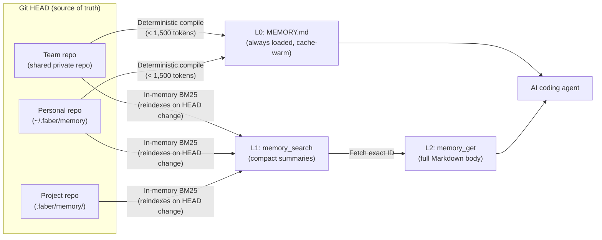

# FaberSEP Memory: User Guide and Reference

The [README](../README.md) gets you started in plain words. This page is the technical side: how it works inside, every setup option, every command and where each file lives.

- [How it works](#how-it-works)
- [Where files live](#where-files-live)
- [Connecting engines (`init`)](#connecting-engines-init)
- [Importing existing notes](#importing-existing-notes)
- [Reviewing proposals](#reviewing-proposals)
- [Team mode (shared private repo)](#team-mode-shared-private-repo)
- [Writing a memory file by hand](#writing-a-memory-file-by-hand)
- [Health and usage (`doctor`, `stats`)](#health-and-usage-doctor-stats)
- [Updating and cleaning up](#updating-and-cleaning-up)
- [CLI command reference](#cli-command-reference)
- [MCP tools](#mcp-tools)
- [Specs](#specs)

---

## How it works



1. **Git is the single source of truth.** Every active memory entry is a small Markdown file committed to Git (`HEAD`). Uncommitted files are never silently trusted.
2. **Three layers keep context small and prompt-cache friendly:**
   - **L0 (`MEMORY.md`):** a short, deterministic table of contents compiled from your active `team` and `personal` entries (hard cap: 1,500 estimated tokens). It has no timestamps, pending counts or machine paths, so the prompt prefix stays byte-identical from turn to turn and the provider's prompt cache keeps working. The header names the package version, so the prefix changes once per upgrade.
   - **L1 (`memory_search`):** the agent searches with a built-in pure-JS BM25 index and gets compact summaries back. BM25 matches words, not meanings: "package manager" will not find an entry that only says "pnpm". See [why BM25](why-faber-memory.md#5-why-pure-js-bm25-instead-of-embeddings--semantic-search).
   - **L2 (`memory_get`):** the agent fetches the full Markdown body only for the entry it needs.
3. **Agents propose; humans approve (`pre-memory`).** Active memory is read-only for agents. `memory_propose` stages a proposal in `pre-memory`; you approve it with `review` or `approve`, and approvals land in one Git commit followed by an L0 recompile.
4. **Three scopes:**
   - **`personal`:** your own rules and preferences in a local Git repo (default `~/.faber/memory`).
   - **`team`:** shared rules in a private team Git repo.
   - **`project`:** optional repo-specific memory in `<repo>/.faber/memory/`. It is searchable but never compiled into the global L0.

## Where files live

| What | Default path |
| :--- | :--- |
| Personal memory repo | `~/.faber/memory` (`setup [path]` to choose another) |
| Config | `~/.config/faber-memory/config.json` |
| Compiled L0 index | `~/.config/faber-memory/state/MEMORY.md` |
| Pending proposals (`pre-memory`) | `~/.config/faber-memory/state/pre-memory/<root-uuid>/` |
| Team serving clone | `~/.config/faber-memory/clones/team` (`setup --team ... --path <dir>` to choose another) |
| Local metrics ledger (v0.2) | `~/.config/faber-memory/state/metrics.jsonl` |
| Project memory | `<repo>/.faber/memory/` |

Set `FABER_MEMORY_HOME` to move everything under `~/.config/faber-memory` somewhere else (useful for tests and sandboxes).

## Connecting engines (`init`)

`init` compiles L0 first, backs up every touched file as `.bak`, writes a marked `<!-- faber-memory:start --> ... <!-- faber-memory:end -->` block, and registers the `faber-memory` MCP server (`npx -y @fabersep/memory serve`). `init --undo` removes the block and the server entry and keeps your memory repos and proposals.

To see the exact Before/After diff without changing anything, run `init --preview` (alias `--dry-run`). `--apply` is still accepted and does the same as plain `init`.

Without `--engine`, `init` targets the engines it finds (`~/.claude`, `~/.gemini`, `~/.cursor`), or Claude Code if it finds none.

```bash
npx @fabersep/memory init --engine claude-code,antigravity
npx @fabersep/memory init --engine claude-desktop   # Claude Desktop is not auto-detected
```

| Engine | Instruction file | MCP config | Notes |
| :--- | :--- | :--- | :--- |
| **Claude Code** | `~/.claude/CLAUDE.md` (`@path` include) | `~/.claude.json` | L0 include, tool guidance line and MCP tools |
| **Antigravity** | `~/.gemini/GEMINI.md` (read-at-start rule) | `~/.gemini/config/mcp_config.json` | Reads L0 at start, tool guidance line and MCP tools |
| **Claude Desktop** | none | `claude_desktop_config.json` | MCP tools only (`--engine claude-desktop`) |
| **Cursor** | none (gap) | `~/.cursor/mcp.json` | MCP tools only |
| **Codex** | none (gap) | none | Configure the MCP server by hand |

The instruction block includes one fixed line that tells the agent to use `memory_search` / `memory_get` for details and to call `memory_propose` when it learns a durable rule, decision, lesson or preference. The line never changes between sessions, so it does not hurt prompt caching.

`init` never changes your engine's own settings. If you use Claude Code and don't want two memory systems at once, see [disabling Claude auto-memory](troubleshooting.md#claude-auto-memory).

The MCP entry runs the latest published version through `npx`. To pin a version, edit the entry's args to `@fabersep/memory@<version>`, or install globally and point the entry at `faber-memory serve`.

## Importing existing notes

Import is deterministic and spends no LLM tokens. Everything goes to `pre-memory` first.

```bash
# Any folder of Markdown (.md) files
npx @fabersep/memory import --from markdown-dir ./path/to/notes

# Claude Code auto-memory folder
npx @fabersep/memory import --from claude-memory ~/.claude/projects/<your-project>/memory

# One AGENTS.md or CLAUDE.md, one entry per # / ## heading
npx @fabersep/memory import --from agents-md ./AGENTS.md --split-headings

# Cursor rules
npx @fabersep/memory import --from cursor-rules ./.cursor/rules
```

- Frontmatter (`id`, `type`, `summary`) is inferred. Index files (`MEMORY.md`, `CATALOG.md`, `README.md`, `INDEX.md`) are skipped, and near-duplicates of active entries are skipped.
- With `--split-headings`, a heading that has nothing under it but other headings (such as a `# Rules` title) is not turned into an entry.
- **Hygiene:** items with secrets or machine-specific paths are left out, and the command ends with a `NOT imported: N item(s)` line. Add `--normalize-paths` to turn `/Users/<name>/` and `/home/<name>/` into `~/` in the staged copy (your source files stay untouched). See [machine-specific paths](troubleshooting.md#machine-specific-paths).
- `--scope team|project` imports into another scope. `--approve` approves right away (personal scope only).

## Reviewing proposals

```bash
npx @fabersep/memory review
```

The review shows a progress line (`[ 1 / 17 ]  Approved: 0 | Rejected: 0 | Skipped: 0`) and one card per proposal:

| Key | Action |
| :--- | :--- |
| `a` | Approve (queued for one batch commit) |
| `e` | Edit the body, then approve |
| `r` | Reject and delete |
| `s` | Skip for now |
| `v` | View the full body of a truncated entry |
| `b` | Back to the previous proposal |
| `q` | Quit and save (`Ctrl+C` also saves) |

Shortcuts: `review --approve-all`, `approve <id1> <id2>`, `reject <id>`, `reject --all`. The new L0 applies to new sessions; reviewing at the end of a session keeps the running session's prompt cache intact.

## Team mode (shared private repo)

Team mode shares rules across a team, or across your own machines, through a private Git repo.

```bash
# 1. Clone and register the team repo (HTTPS, github.com/org/repo, org/repo or SSH)
npx @fabersep/memory setup --team https://github.com/your-org/team-memory.git
#    Optional: --path ~/team-memory   (default: ~/.config/faber-memory/clones/team)

# 2. Connect your engines (skip if done already)
npx @fabersep/memory init

# 3. Optional: import notes into the team scope
npx @fabersep/memory import --from markdown-dir ./notes --scope team

# 4. Review and approve (pushes to the team repo, then recompiles L0)
npx @fabersep/memory review

# Later: pull teammates' changes
npx @fabersep/memory sync
```

**How team approvals are pushed:**

- **`auto` (default):** pushes **straight to the team repo's default branch** from a clean temporary worktree. If branch protection rejects the push, it creates a branch and opens a PR instead.
- **`pr`:** always opens a PR. Choose this if team rules should always get a second pair of eyes: `npx @fabersep/memory config set-submit-mode pr`.

> **Warning:** with `auto` and an unprotected default branch, an approval goes live for the whole team at once. Protect the branch or use `pr` mode for shared teams.

Run `npx @fabersep/memory compile --check` in the team repo's CI to block schema errors, duplicates, an over-budget L0 and hygiene violations.

## Writing a memory file by hand

```markdown
---
id: no-broad-process-kill
type: rule
scope: personal
summary: Never run pkill or killall by broad pattern; stop only your own PID or task.
tags: [safety, shell]
---

Never kill processes by broad name patterns like `pkill node` or `killall python`.
Always stop only the specific PID or background task you started.
```

Valid `type` values: `rule`, `decision`, `lesson`, `preference`, `reference`. Commit the file with Git, then run `npx @fabersep/memory compile`.

## Health and usage (`doctor`, `stats`)

**`doctor`** is a read-only checklist (`PASS` / `WARN` / `FAIL`, each with a fix hint) of: config and Git roots, the compiled L0 (missing, stale or over budget), schema, IDs and hygiene, engine wiring, the `pre-memory` queue (stale or failed proposals), and L0 stability (how often it changed in the last 7 days). It exits `1` on any `FAIL`, or on any `WARN` with `--strict`. `--json` prints the report as JSON.

**`stats`** reads a local, private metrics ledger (it never leaves your machine) and reports:

- context size: L0 tokens, MCP tool schema tokens, corpus size;
- retrieval: searches, gets, hit rates, and "cold" entries nobody has read lately;
- the proposal funnel: proposed, approved, rejected, blocked by hygiene or duplicates;
- with `--cache`: the measured prompt-cache hit rate from your engine's local logs (Claude Code, Antigravity);
- with `--share`: an anonymized benchmark card (no IDs, paths, names or models) you can post if you want.

Options: `--days 1..90`, `--engine claude-code|antigravity|all`, `--log-dir <path>`, `--json`.

## Updating and cleaning up

**Update:**

- With `npx`: `npx @fabersep/memory@latest --version` fetches the newest release and prints its version.
- Global install: `npm install -g @fabersep/memory@latest`.
- From source: `git pull && npm install && npm run build`.

Your repos and config keep working. Re-running `init` after an update is safe and idempotent.

**Clean up:**

| Goal | Command |
| :--- | :--- |
| Disconnect engines, keep everything else | `npx @fabersep/memory init --undo` |
| Clear all pending proposals | `npx @fabersep/memory reject --all` |
| Forget a root without deleting its files | `npx @fabersep/memory config unset personal` (or `team`) |
| Full reset: undo wiring and delete `~/.config/faber-memory` (config, L0, proposals, metrics and the team clone) | `npx @fabersep/memory reset` (add `--include-personal-repo` to also delete `~/.faber/memory`) |

**Global install or source checkout:**

```bash
npm install -g @fabersep/memory
faber-memory --help
```

```bash
git clone https://github.com/fabersep/memory.git
cd memory
npm install
npm test
npm link
```

## CLI command reference

`faber-memory` below is the global command; with `npx`, use `npx @fabersep/memory` instead.

| Command | Description |
| :--- | :--- |
| `setup [path]` | Create a personal memory Git repo (default `~/.faber/memory`). |
| `setup --team <url\|org/repo> [--path <dir>] [--submit-mode auto\|pr]` | Clone and register a shared team repo. |
| `config` | Print `~/.config/faber-memory/config.json`. |
| `config set-path <personal\|team> <new-path>` | Move a configured root, keeping its UUID. |
| `config set-submit-mode <auto\|pr>` | Change how team approvals are pushed. |
| `config unset <personal\|team>` | Forget a root without deleting files. |
| `init [--preview \| --undo] [--engine ...] [--project-hint]` | Connect engines (with `.bak` backups), preview the diff only (`--preview`, alias `--dry-run`), or undo. |
| `compile [--check] [--repo <dir>]` | Compile L0 `MEMORY.md`, or validate schema, budget and hygiene (`--check`, for CI). |
| `sync [--timeout <ms>]` | Fast-forward pull remote changes and recompile L0. |
| `status` | Show the compiled L0, configured roots, warnings and pending or stale proposals. |
| `doctor [--json] [--strict]` | Read-only health checklist with fix hints. |
| `stats [--days 1..90] [--json] [--cache] [--engine ...] [--log-dir <path>] [--share]` | Local usage, retrieval and prompt-cache metrics. |
| `review [--approve-all]` | Review `pre-memory` proposals interactively. |
| `approve <id...> [--mode auto\|pr]` | Approve proposals by ID in one batch commit. |
| `reject <id>` / `reject --all [--yes]` | Reject one or all pending proposals. |
| `reset [--include-personal-repo] [--yes]` | Undo wiring and delete local state. |
| `import --from <type> <path> [--scope ...] [--split-headings] [--normalize-paths] [--approve]` | Import existing notes into `pre-memory`. |
| `serve` | Run the 3-tool stdio MCP server (your engine's MCP config calls this). |
| `--version` | Print the installed version. |

## MCP tools

The server exposes exactly three tools (a few hundred tokens of schema in total) and never sends tool-list change notifications.

| Tool | Purpose |
| :--- | :--- |
| `memory_search` | BM25 search over active `team`, `personal` and `project` entries; returns compact L1 summaries. An empty query lists entries. Reindexes when Git `HEAD` changes. |
| `memory_get` | Full L2 Markdown body, frontmatter and links for one or more IDs. |
| `memory_propose` | Stage a `create`, `update` or `supersede` proposal in `pre-memory` for human approval. Never writes active memory. |

## Specs

This repository follows the [FaberSEP Spec](https://github.com/fabersep/spec) standard:

- [Master PRD](master-prd.md) and [Architecture](architecture.md)
- [01 Core memory](features/01-core-memory/prd.md) and its [acceptance criteria](features/01-core-memory/acceptance_criteria.md)
- [02 Metrics and stats](features/02-metrics-and-stats/prd.md) and its [acceptance criteria](features/02-metrics-and-stats/acceptance_criteria.md)
